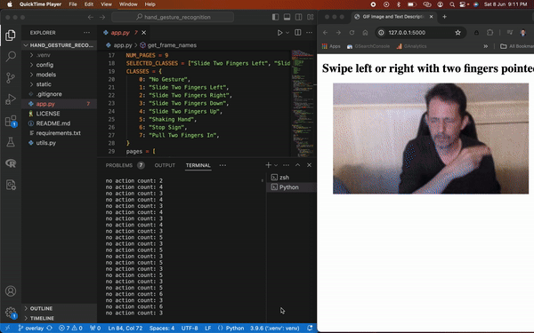

# Hand Gesture Recognition

**Touch-free control of an information display with hand gestures, recognised live from a webcam.**

Swipe two fingers left or right in front of the camera to move through an exhibit that explains the parts of a computer (CPU, RAM, GPU, motherboard, storage, network card, power supply and fan). After 20 seconds without a gesture, the display returns to the home page.



## How it works

```
webcam ─► OpenCV frames ─► 18-frame clip ─► 3D CNN (PyTorch) ─► gesture ─► Flask-SocketIO ─► browser page changes
```

- **Model:** a 3D convolutional network (four Conv3d + BatchNorm + ELU + MaxPool blocks, then two fully connected layers; `ConvColumn` in [`utils.py`](utils.py)). It reads a short video clip, so it sees motion over time, not just a single image.
- **Training data:** the 20BN Jester hand-gesture dataset, using 8 classes: no gesture, slide two fingers left / right / up / down, shaking hand, stop sign and pull two fingers in. The display uses left and right swipes.
- **Inference:** frames are resized, centre-cropped to 84×84, grouped into clips and classified on CPU or GPU. Recent predictions are kept in a short buffer, so the display only resets after a stretch of "no gesture".
- **Display:** a Flask app serves the pages and pushes page changes to the browser over WebSockets (Flask-SocketIO), so the page updates instantly without reloading.
- **Deployment:** [`model_conversion.py`](model_conversion.py) exports the model to ONNX (`models/model.onnx`) for lighter runtimes. `utils.py` has hooks to light LEDs through Raspberry Pi GPIO pins for each page; they are switched off in this version.

## Run it

```bash
python3 -m venv venv
source venv/bin/activate
python3 -m pip install --upgrade pip
python3 -m pip install -r requirements.txt

python3 app.py
```

Then open http://localhost:5001 in a browser. If the webcam isn't found, run `python3 debug/find_camera_index.py` to see which camera index works.

## Repository layout

| Path | What it is |
|---|---|
| `app.py` | Webcam capture, gesture inference and the Flask-SocketIO server |
| `utils.py` | The 3D CNN, config loading and GPIO hooks |
| `config/config.json` | Model and training settings (clip size, number of classes, checkpoint path) |
| `models/` | Trained PyTorch checkpoint and the ONNX export |
| `static/` | The display pages and their animations |
| `model_conversion.py` | Exports the model to ONNX |
